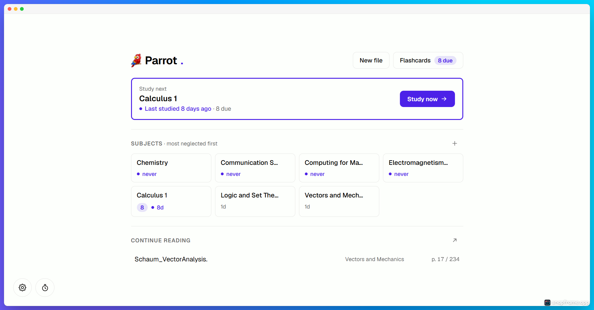

# Parrot



A local-first study reader for PDFs: textbooks, lecture notes and research papers. Sort your files
into subjects, read and highlight them, take notes, ask an AI about any passage or figure, and
turn what you read into spaced-repetition flashcards. Everything runs on your own machine; fork it
and go.

## Features

### Home screen

- **Study next**: the subject that needs you most, with one button to start.
- **Subjects**: a tile for each school subject, the ones you haven't touched for longest first
  (7+ days is flagged), with how many cards are due. Each subject has its own page with tabs for
  its flashcards, its notes & highlights across every file, and its files.
- **Continue reading**: the file you last had open. Every file is in **All files**, which you
  can search, and where you can rename a file, move it to another subject, or remove it.
- **New file**: pick a PDF and choose the subject it belongs to.
- **Deadline calendar**: a tear-off wall calendar that counts the days to your nearest
  deadline. It flips to a new page each day, and you click it to see, add, edit or remove your
  deadlines.
- **Light / dark theme** toggle, plus the **Settings** and **Focus timer** buttons in the
  corner.

### Reader

- Continuous-scroll PDF reader with zoom, a page box, and reopening at the last page you read.
- **Contents** sidebar to jump to any section, and a **Notes** tab listing every note and
  highlight by page.
- **Find** (Ctrl/⌘+F) searches the whole document, not just the pages on screen.
- **Reading modes**: Light, Sepia and Dark.

### Highlights and notes

- Select text for a menu of **Copy**, **Highlight**, **Ask Parrot**, **Note** and **Flashcard**.
- Highlights come in several colours, are saved, and stay aligned at any zoom.
- **Notes** support Markdown and LaTeX (`$x^2$`, `$$…$$`) with Write / Preview. Attach a note to
  selected text, to a region with the **note pen**, or to the page itself with **New note**.
- The note window opens large and centred; drag it by its header and resize it from the corner.

### Ask Parrot (AI)

- Chat about selected text, or use the **AI pen** to capture a figure, table or equation and ask
  about it.
- Replies render Markdown and LaTeX.
- **Save** a thread and it's pinned to a highlight; click the highlight to reopen it.
- Works with 9 providers, including local models (see below), and can optionally search the web.

### Flashcards (spaced repetition)

- Make cards by hand, or let the AI draft one from selected text for you to review and save.
- Each card remembers where it came from (page and section) and jumps back there. Add your own
  tags, and review by section or tag.
- **Study sessions** schedule cards with FSRS: grade each one Again / Hard / Good / Easy, and the
  buttons show when you'll see it next. Due cards plus up to 20 new ones a day.
- Cards move from *new* through *learning*, *familiar* and *confident* to *mastered* as you
  learn them.
- Study one document's deck in the reader, one subject from its page, or everything from
  **Flashcards** on the home screen.

### Focus timer

- A Pomodoro timer in a floating window that keeps running while you move between files and
  survives a reload.
- Adjustable focus and break lengths, and a day streak.

## Keyboard shortcuts (in the reader)

| Key | Action |
| --- | --- |
| Ctrl/⌘+F | Find in document |
| Ctrl/⌘+B | Contents sidebar |
| N | New note on this page |
| F | This document's flashcards |
| Shift+F | New flashcard |
| Esc | Close the open window |

## Stack

- **Next.js** (App Router) + **React**, run with **Bun**
- **Base UI** headless components, styled with plain CSS Modules (no Tailwind)
- **better-sqlite3** for everything stored locally
- **react-pdf** (pdf.js) for rendering; **react-markdown** + **KaTeX** for notes and replies
- **ts-fsrs** for flashcard scheduling
- **Vercel AI SDK** harness — multi-provider (Claude, GPT, Google Gemini, xAI, Groq, OpenRouter,
  Ollama, LM Studio, and any OpenAI-compatible endpoint), with an optional web-search tool

## Getting started

The app lives in `app/`; run everything from there.

```bash
cd app
bun install
bun run dev
```

Open [http://localhost:3000](http://localhost:3000).

## Where your data lives

Parrot keeps everything in an app-data folder in your home directory, never in the repo:

```
~/.parrot/
  parrot.db      SQLite: documents, subjects, highlights & notes, chats, flashcards and
                 reviews, focus sessions, deadlines, settings
  pdfs/          your uploaded PDFs, one file per document
  config.json    optional API keys (see below)
```

To reset Parrot, delete `~/.parrot`.

## Configure an AI provider

API keys are never written to `parrot.db`. Put them in `app/.env.local`, starting from the
example file:

```bash
cd app
cp .env.example .env.local
```

…or in `~/.parrot/config.json`, keyed by provider id (environment variables win if both are set):

```json
{
  "anthropic": { "apiKey": "sk-ant-…" },
  "tavily": { "apiKey": "tvly-…" }
}
```

Then open **Settings** (gear, bottom-left of the home screen) to pick the active provider and
model. Local runtimes (Ollama, LM Studio) need no key — just their base URL. Supported keys:

| Provider | Env var | `config.json` id | Notes |
| --- | --- | --- | --- |
| Claude | `ANTHROPIC_API_KEY` | `anthropic` | |
| OpenAI | `OPENAI_API_KEY` | `openai` | |
| Google (Gemini) | `GOOGLE_GENERATIVE_AI_API_KEY` | `google` | |
| xAI (Grok) | `XAI_API_KEY` | `xai` | |
| Groq | `GROQ_API_KEY` | `groq` | |
| OpenRouter | `OPENROUTER_API_KEY` | `openrouter` | |
| Ollama | — | `ollama` | `OLLAMA_BASE_URL` (default `http://localhost:11434/v1`) |
| LM Studio | — | `lmstudio` | `LMSTUDIO_BASE_URL` (default `http://localhost:1234/v1`) |
| OpenAI-compatible | `OPENAI_COMPATIBLE_API_KEY` | `openai-compatible` | set the base URL in Settings |

Ask Parrot and AI-drafted flashcards send the selected text (or the cropped region image) to your
configured provider; with web search on, the model's search queries go to your search backend.
Your files, notes and cards stay on your machine.

## Web search (optional)

Give the AI a `web_search` tool it can call for current information — recent papers, latest
results, an author's other work, anything past the model's knowledge cutoff. It's **off by
default**; enable it and pick a backend in **Settings → Web search**. Bring your own key:

| Backend | Env var | `config.json` id |
| --- | --- | --- |
| Tavily | `TAVILY_API_KEY` | `tavily` |
| Exa | `EXA_API_KEY` | `exa` |

The tool is only offered to the model when web search is enabled **and** a key is present, so it
works with any provider that supports tool calls — including local runtimes.

## Share it as a Windows app

```bash
cd app
bun run package:win
```

This builds `app/dist/parrot-windows.zip`: a standalone server with a portable `node.exe` and a
**Start Parrot** launcher (it serves on `http://127.0.0.1:3737`, this machine only). The recipient
needs nothing installed. Their data goes to their own `%USERPROFILE%\.parrot`, and AI features use
the keys in their `config.json`. Your `.env` files are left out of the package.
